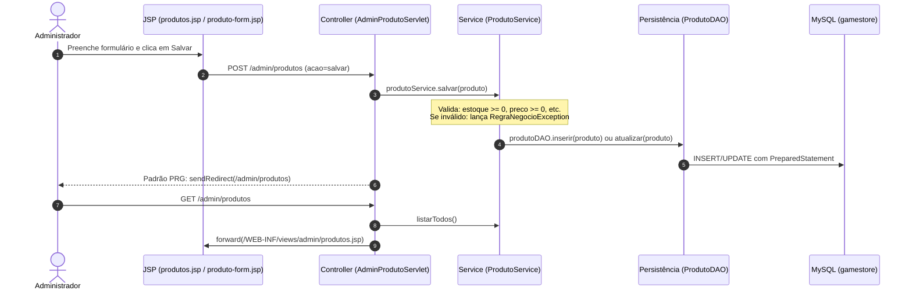

# 🎓 Guia de Apresentação & Defesa Técnica — Módulo 1 (Catálogo Admin)

> **Módulo:** 1 — Catálogo & Área Administrativa (Admin)  
> **Disciplina:** WEB 2 (Java EE Web) — 4º Semestre / TSI - IFSP  
> **Responsável:** Gustavo (`agbram`)  
> **Tecnologias:** Jakarta EE 10, Servlets 6.0, JSTL 3.0, Expression Language (EL), HikariCP, MySQL 8.0, JUnit 5.

---

## 📌 1. Visão Geral do que foi Construído

O **Módulo 1** é a espinha dorsal de produtos da loja virtual:
1. **CRUD de Plataformas:** Cadastrar, listar e excluir plataformas de jogos (Steam, PlayStation, Xbox, Riot, etc.).
2. **CRUD de Gift Cards:** Cadastrar, listar, editar preço/estoque, alternar status (Ativar/Inativar) e excluir.
3. **Regras de Negócio Obrigatórias:**
   - Bloquear cadastro/atualização com estoque ou preço de venda negativos.
   - Bloquear valor de crédito menor ou igual a zero.
   - **Regra Crítica:** Impedir a exclusão física de qualquer Gift Card que já possua vendas registradas em `item_pedido`.

---

## 🏛️ 2. Arquitetura em Camadas (Fluxo da Aplicação)



---

## 🎤 3. Roteiro de Apresentação ao Vivo (2 a 3 minutos)

| Passo | Ação na Tela | O que Falar para o Professor |
| :---: | :--- | :--- |
| **1** | Acessar `/admin/produtos` | *"Professor, fiquei responsável pelo Módulo 1. Aqui temos a visão geral do catálogo de Gift Cards com preços formatados, controle de estoque e status."* |
| **2** | Clicar em **🎮 Plataformas** | *"Antes de criar um produto, o administrador gerencia as plataformas parceiras. Vou cadastrar uma nova plataforma aqui ao vivo."* |
| **3** | Clicar em **+ Novo Gift Card** | *"Todo Gift Card está associado a uma plataforma via chave estrangeira. Vou selecionar a plataforma recém-criada e preencher os dados."* |
| **4** | **Demonstrar a Validação** | *"Se eu tentar colocar estoque negativo (`-5`) ou preço negativo, o sistema não aceita. A validação não é apenas no HTML, ela é disparada no `ProdutoService` com `RegraNegocioException`."* |
| **5** | **Demonstrar Inativação** | *"Para tirar um card de circulação sem quebrar o histórico de compras dos clientes que já o adquiriram, usamos o botão 'Inativar'."* |

---

## ❓ 4. As 7 Perguntas do Professor com Respostas & Trechos de Código

### Pergunta 1: *"Por que você usou o Padrão PRG (Post-Redirect-Get) no Servlet?"*
> **Resposta:**  
> *"Utilizamos o PRG em todas as requisições que alteram dados (`doPost`). Se fizéssemos um `forward` direto para o JSP após salvar, caso o usuário pressionasse **F5 (Refresh)** no navegador, o formulário seria reenviado e duplicaria o registro no banco. Com o PRG, o Servlet processa os dados, grava a mensagem de sucesso na sessão (**Flash Attribute**) e faz um `response.sendRedirect()`. O navegador então faz um **GET** limpo para carregar a listagem."*

**Trecho no Código:** `AdminProdutoServlet.java`
```java
@Override
protected void doPost(HttpServletRequest request, HttpServletResponse response) throws IOException {
    String acao = request.getParameter("acao");
    HttpSession session = request.getSession();

    try {
        if ("salvar".equalsIgnoreCase(acao)) {
            salvarProduto(request);
            session.setAttribute("sucesso", "Gift Card salvo com sucesso!");
        } else if ("status".equalsIgnoreCase(acao)) {
            // ...
        }
    } catch (RegraNegocioException e) {
        session.setAttribute("erro", e.getMessage());
    }

    // PADRÃO PRG: Redireciona sempre ao final de requisições POST
    response.sendRedirect(request.getContextPath() + "/admin/produtos");
}
```

---

### Pergunta 2: *"Onde mora a regra de negócio do seu módulo e por que ela não está no Servlet?"*
> **Resposta:**  
> *"A regra de negócio mora exclusivamente na camada de serviço (`ProdutoService.java`).  
> O Servlet é responsável unicamente pelo protocolo HTTP (obter parâmetros da requisição e despachar views). Se colocássemos regras no Servlet, violaríamos o princípio da responsabilidade única (SRP) e não conseguiríamos executar testes unitários automatizados sem subir um container web como o Tomcat."*

**Trecho no Código:** `ProdutoService.java`
```java
private void validarProduto(Produto p) {
    if (p == null) {
        throw new RegraNegocioException("Os dados do Gift Card não foram informados.");
    }
    if (p.getTitulo() == null || p.getTitulo().trim().isEmpty()) {
        throw new RegraNegocioException("O título do Gift Card é obrigatório.");
    }
    if (p.getPlataformaId() <= 0) {
        throw new RegraNegocioException("Selecione uma plataforma válida.");
    }
    if (p.getValorCredito() == null || p.getValorCredito().compareTo(BigDecimal.ZERO) <= 0) {
        throw new RegraNegocioException("O valor de crédito deve ser maior que zero (R$ 0,00).");
    }
    if (p.getPrecoVenda() == null || p.getPrecoVenda().compareTo(BigDecimal.ZERO) < 0) {
        throw new RegraNegocioException("O preço de venda não pode ser negativo.");
    }
    if (p.getEstoque() < 0) {
        throw new RegraNegocioException("A quantidade de estoque não pode ser negativa.");
    }
}
```

---

### Pergunta 3: *"Como você implementou a regra que proíbe excluir um Gift Card que já possui vendas?"*
> **Resposta:**  
> *"No `ProdutoDAO`, criei o método `possuiVendas(int produtoId)`, que faz um `SELECT COUNT(*) FROM item_pedido WHERE produto_id = ?`.  
> No `ProdutoService`, antes de chamar o `excluir`, eu consulto esse método. Se retornar verdadeiro, o Service impede a exclusão disparando `RegraNegocioException` orientando o admin a apenas inativar o card."*

**Trecho no Código — Service:**
```java
public void excluir(int id) {
    buscarPorId(id); // Garante que o produto existe

    // REGRA DE NEGÓCIO OBRIGATÓRIA:
    if (produtoDAO.possuiVendas(id)) {
        throw new RegraNegocioException(
            "Não é permitido excluir este Gift Card pois ele já possui vendas registradas no sistema. " +
            "Para tirá-lo de circulação, altere o status para 'Inativo'."
        );
    }

    produtoDAO.excluir(id);
}
```

**Trecho no Código — DAO:**
```java
public boolean possuiVendas(int produtoId) {
    String sql = "SELECT COUNT(*) FROM item_pedido WHERE produto_id = ?";
    try (Connection conn = ConnectionFactory.getConnection();
         PreparedStatement ps = conn.prepareStatement(sql)) {

        ps.setInt(1, produtoId);
        try (ResultSet rs = ps.executeQuery()) {
            if (rs.next()) {
                return rs.getInt(1) > 0;
            }
        }
        return false;
    } catch (SQLException e) {
        throw new RuntimeException("Erro ao verificar vendas do produto: " + e.getMessage(), e);
    }
}
```

---

### Pergunta 4: *"Por que os arquivos JSP estão dentro de `/WEB-INF/views/` e não na pasta pública?"*
> **Resposta:**  
> *"Para proteção contra acesso direto via URL. Qualquer arquivo sob o diretório `/WEB-INF/` é bloqueado pelo servidor de aplicação (Tomcat). O usuário não consegue acessar as telas administrativas digitando `localhost:8080/.../produtos.jsp`. O acesso só é possível se for despachado internamente pelo Servlet através de `RequestDispatcher.forward()`, garantindo que o fluxo passe pelo controller e as listas sejam devidamente carregadas."*

---

### Pergunta 5: *"Você usou Scriptlets (`<% ... %>`) nas telas JSP?"*
> **Resposta:**  
> *"Não, utilizamos zero scriptlets, seguindo as boas práticas do Jakarta EE. Toda a lógica de renderização na view foi feita com **JSTL** (`<c:forEach>`, `<c:if>`, `<c:choose>`, `<fmt:formatNumber>`) e **Expression Language (`${...}`)**. Além disso, o CSS foi completamente desacoplado no arquivo estático `modules.css`."*

**Trecho no Código:** `produtos.jsp`
```jsp
<c:forEach var="p" items="${produtos}">
    <tr>
        <td>#${p.id}</td>
        <td><span class="badge badge-platform">${p.plataformaNome}</span></td>
        <td><strong>${p.titulo}</strong></td>
        <td>R$ <fmt:formatNumber value="${p.valorCredito}" minFractionDigits="2" maxFractionDigits="2"/></td>
        <td>R$ <fmt:formatNumber value="${p.precoVenda}" minFractionDigits="2" maxFractionDigits="2"/></td>
        <td>${p.estoque} un.</td>
    </tr>
</c:forEach>
```

---

### Pergunta 6: *"Como é feita a prevenção de SQL Injection no seu módulo?"*
> **Resposta:**  
> *"No `ProdutoDAO` e `PlataformaDAO`, todas as consultas são preparadas utilizando `PreparedStatement` com parâmetros posicionais (`?`). Os dados fornecidos pelo usuário nunca são concatenados diretamente na String SQL, garantindo que o driver JDBC do MySQL trate as entradas estritamente como literais de dados."*

---

### Pergunta 7: *"Como você testou as regras de negócio sem precisar subir o Tomcat ou abrir o navegador?"*
> **Resposta:**  
> *"Criamos uma suíte de testes unitários com **JUnit 5** na classe `ProdutoServiceTest`.  
> Utilizando injeção de dependência via construtor do `ProdutoService`, passamos um stub do `ProdutoDAO` para simular cenários de produtos com e sem vendas, testando de forma isolada as exceções de estoque negativo, preço negativo, crédito zerado e exclusão bloqueada."*

**Trecho no Código:** `ProdutoServiceTest.java`
```java
@Test
@DisplayName("Nao deve permitir excluir Gift Card que ja possua vendas registradas")
void deveBloquearExclusaoDeProdutoComVendas() {
    ProdutoDAO daoStub = new ProdutoDAO() {
        @Override
        public Produto buscarPorId(int id) {
            return new Produto(id, 1, "PlayStation Store R$ 100", new BigDecimal("100.00"), new BigDecimal("95.00"), 2, true);
        }
        @Override
        public boolean possuiVendas(int produtoId) {
            return true; // Simula venda registrada
        }
    };

    ProdutoService service = new ProdutoService(daoStub);

    RegraNegocioException ex = assertThrows(RegraNegocioException.class, () -> service.excluir(1));
    assertTrue(ex.getMessage().contains("já possui vendas registradas"));
}
```

---

## 📁 5. Resumo dos Arquivos Entregues no Módulo 1

| Camada | Arquivo | Responsabilidade |
| :--- | :--- | :--- |
| **Banco** | `database.sql` | DDL das tabelas `plataforma` e `produto` com FKs e índices |
| **Model** | `Plataforma.java`, `Produto.java` | JavaBeans encapsulados com Lombok |
| **Persistência** | `PlataformaDAO.java`, `ProdutoDAO.java` | Consultas com `PreparedStatement` e `HikariCP` |
| **Negócio** | `PlataformaService.java`, `ProdutoService.java` | Validações e disparos de `RegraNegocioException` |
| **Controle** | `AdminPlataformaServlet.java`, `AdminProdutoServlet.java` | Rotas com `@WebServlet`, padrão PRG e Flash Attributes |
| **Apresentação** | `produtos.jsp`, `produto-form.jsp`, `plataformas.jsp`, `modules.css` | Páginas protegidas em `/WEB-INF/` com JSTL e EL |
| **Testes** | `ProdutoServiceTest.java` | Testes unitários com JUnit 5 |
